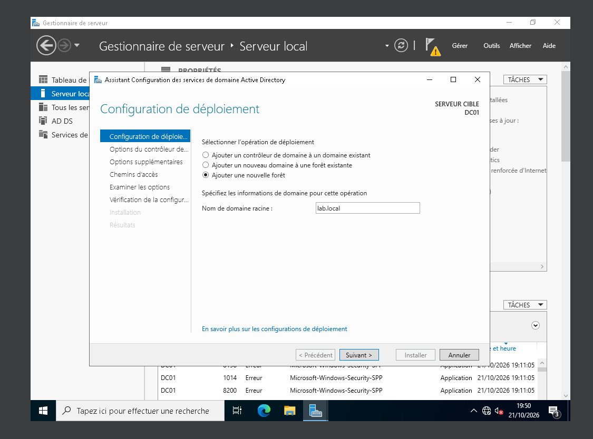
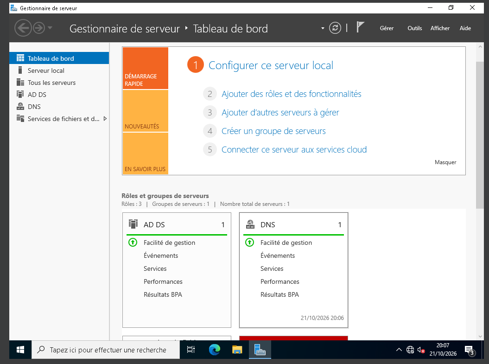
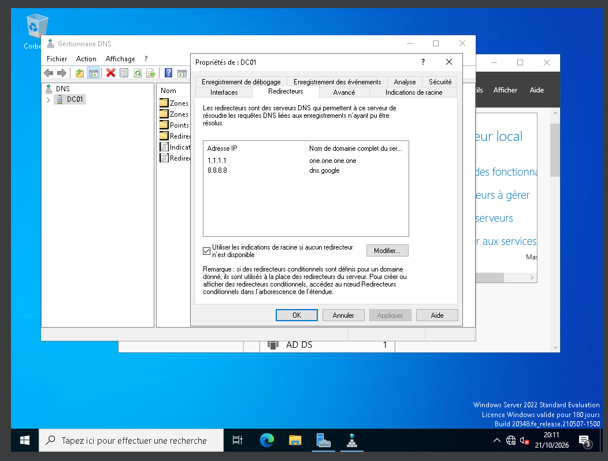
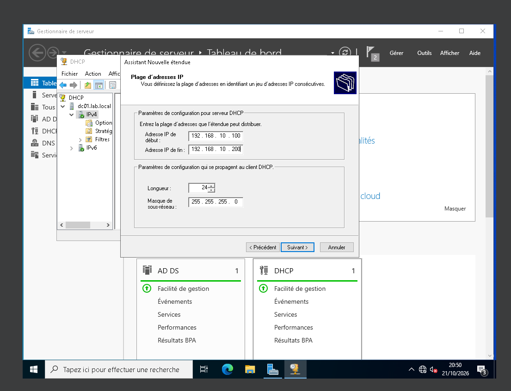
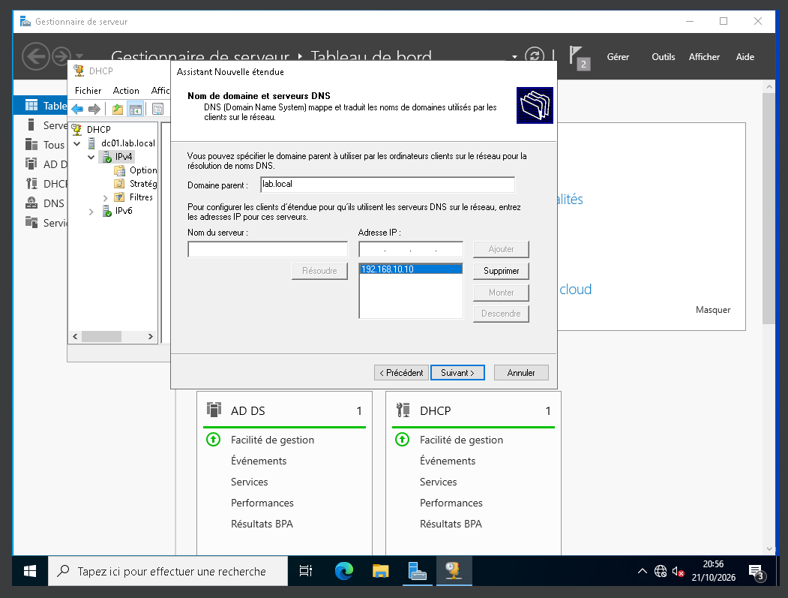

# Homelab Active Directory

Lab d'administration Windows réalisé pour préparer mon alternance en administration systèmes, réseaux et sécurité.
Objectif : simuler le système d'information d'une petite entreprise et en assurer l'administration.

## Architecture

| Machine | Rôle | OS | IP |
|---|---|---|---|
| DC01 | Contrôleur de domaine, DNS, DHCP | Windows Server 2022 | 192.168.10.10 (fixe) |
| PC01 | Poste client | Windows 11 Entreprise | DHCP |

- Hyperviseur : VirtualBox, réseau NAT `LabNet` (192.168.10.0/24)
- Domaine : `lab.local` (NetBIOS : `LAB`)
- Passerelle : 192.168.10.1
- DNS : DC01, avec redirecteurs vers 1.1.1.1 et 8.8.8.8
- Plage DHCP : 192.168.10.100 – 192.168.10.200

## Avancement

- [x] Création de la VM et du réseau NAT isolé
- [x] Installation de Windows Server 2022 (Expérience de bureau)
- [x] Renommage et IP fixe
- [x] AD DS et promotion en contrôleur de domaine (forêt `lab.local`)
- [x] DNS : redirecteurs vers Internet
- [x] DHCP : étendue LAN-LAB, serveur autorisé dans l'AD
- [ ] OU, utilisateurs, groupes et script PowerShell de création depuis un CSV
- [ ] Client Windows 11 joint au domaine
- [ ] GPO : mots de passe, lecteur réseau, restrictions
- [ ] Partages et droits NTFS par service

## 1. Installation et configuration réseau


IP fixe : le contrôleur de domaine doit toujours être joignable à la même adresse. Son DNS pointe sur lui-même (`127.0.0.1`), car c'est lui qui héberge la zone `lab.local`.

## 2. Active Directory et DNS





- Nouvelle forêt `lab.local`, niveau fonctionnel Windows Server 2016
- DNS intégré à Active Directory (les postes trouvent le contrôleur de domaine grâce aux enregistrements SRV)
- Redirecteurs : les requêtes externes sont transmises à 1.1.1.1 et 8.8.8.8

Vérification :

```
PS> Get-ADDomain | Format-List DNSRoot, NetBIOSName, PDCEmulator
DNSRoot     : lab.local
NetBIOSName : LAB
PDCEmulator : DC01.lab.local
```

## 3. DHCP




- Serveur autorisé dans l'AD (protection contre les DHCP non autorisés)
- Étendue `LAN-LAB` : 192.168.10.100 à .200, bail de 8 jours
- Options : 003 Routeur, 006 DNS (DC01 uniquement), 015 Nom de domaine

Vérification :

```
PS> Get-DhcpServerv4OptionValue -ScopeId 192.168.10.0
OptionId Name               Value
       3 Routeur            {192.168.10.1}
       6 Serveurs DNS       {192.168.10.10}
      15 Nom de domaine DNS {lab.local}
```
