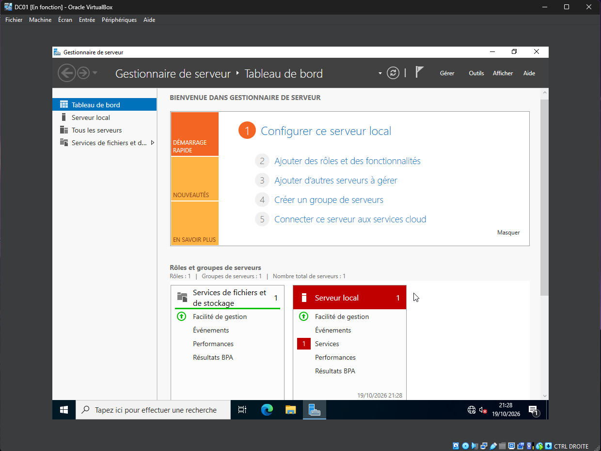
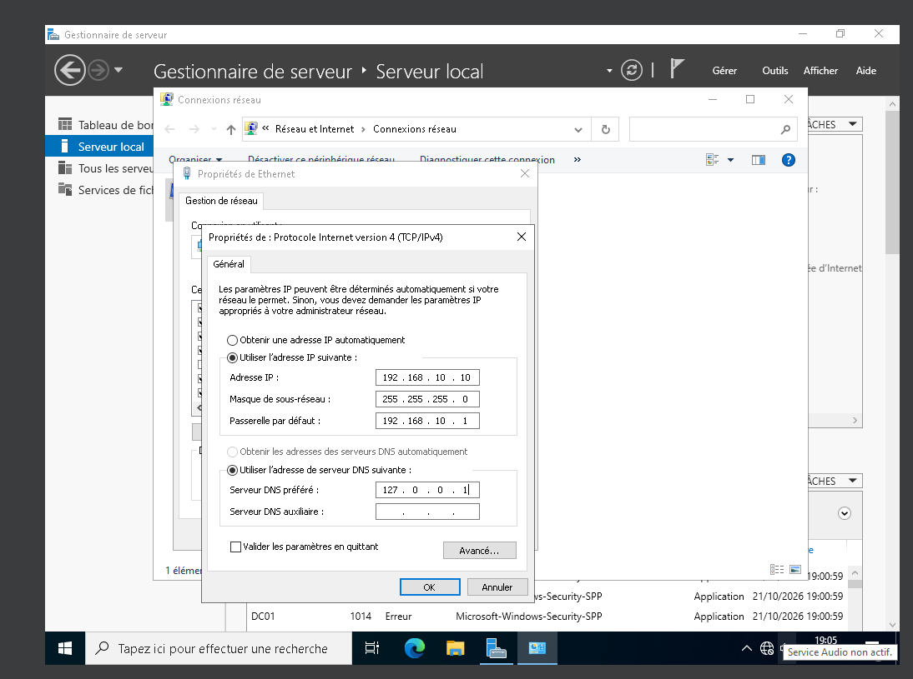

# Homelab Active Directory

Lab d'administration Windows réalisé pour préparer mon alternance en administration systèmes, réseaux et sécurité.
Objectif : simuler le système d'information d'une petite entreprise et en assurer l'administration.

## Architecture

| Machine | Rôle | OS | IP |
|---|---|---|---|
| DC01 | Contrôleur de domaine, DNS, DHCP | Windows Server 2022 | 192.168.10.10 (fixe) |
| PC01 | Poste client | Windows 11 Entreprise | DHCP |

- Hyperviseur : VirtualBox, réseau NAT `LabNet` (192.168.10.0/24)
- Domaine : `lab.local`
- Passerelle : 192.168.10.1
- Plage DHCP : 192.168.10.100 – 192.168.10.200

## Avancement

- [x] Création de la VM et du réseau NAT isolé
- [x] Installation de Windows Server 2022 (Expérience de bureau)
- [x] Renommage et IP fixe
- [ ] AD DS et promotion en contrôleur de domaine (forêt `lab.local`)
- [ ] DHCP
- [ ] OU, utilisateurs, groupes et script PowerShell de création depuis un CSV
- [ ] Client Windows 11 joint au domaine
- [ ] GPO : mots de passe, lecteur réseau, restrictions
- [ ] Partages et droits NTFS par service

## Captures

### Windows Server 2022 installé


### IP fixe de DC01


Vérification (`ipconfig` sur DC01) :

```
Nom de l'hôte . . . . . : DC01
Adresse IPv4. . . . . . : 192.168.10.10
Masque de sous-réseau . : 255.255.255.0
Passerelle par défaut . : 192.168.10.1
Serveurs DNS. . . . . . : 127.0.0.1
```
